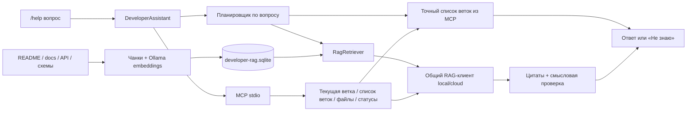

# День 31 — ассистент разработчика

## Задача и границы

Раздел «Ассистент разработчика» и CLI отвечают на `/help` и `/help <вопрос>` по документации этого репозитория и свежему Git-контексту. Обычный вопрос — сокращение для `/help <вопрос>`. Это первая версия помощника для изучения проекта: чтение документации и состояния Git, без редактирования файлов и выполнения произвольных команд.

Кнопка «Открыть папку» подключает любую доступную локальную папку без предварительной настройки JSON. В диалоге можно переходить по каталогам или ввести путь. Выбор автоматически сохраняется в `data/developer-projects.json`, а недавние проекты доступны в списке. В CLI используется `--project ID`. Практическая проверка на Swift-проекте MyFamily, подготовленная для него документация и команды запуска описаны в [day-31-myfamily.md](day-31-myfamily.md).

## Архитектура и план реализации

1. `developer-corpus.ts`: собрать README, `docs`, `project/docs`, API-описания и схемы из разрешённых каталогов. Нормализовать текст существующим `documentFromText`, разбить по разделам через `chunkDocuments`, получить Ollama-эмбеддинги, сохранить в отдельный `data/developer-rag.sqlite` через `RagIndexStore`. Отпечаток содержимого, модели и настроек позволяет обнаруживать изменения и требовать переиндексацию.
2. `project-mcp-server.ts`: отдельный MCP-сервер stdio. Четыре инструмента: `get_git_branch`, `list_git_branches`, `list_project_files`, `get_git_diff`. `get_git_branch` сообщает текущую ветку/commit, а `list_git_branches` читает `refs/heads` и `refs/remotes` через `git for-each-ref`, разделяет локальные и remote-tracking ветки и исключает символические указатели вроде `origin/HEAD`. Fetch и сетевые обращения не выполняются; известные удалённые ветки могут быть устаревшими. Для каждой группы возвращаются имена (до 200), total и truncated. Дополнительный бюджет контекста ограничивает длинные списки без изменения полного receipt; неполный список явно помечается. Последний возвращает имена и статусы staged/unstaged изменений, без содержимого файлов. Корень берётся из выбранного проекта; запросы `/help` и `/index` используют ID, а не произвольный путь или shell-команду. Без Git все четыре инструмента возвращают `available: false` с причиной; RAG по документации продолжает работать. В новом Git-репозитории без коммитов возвращается имя ветки и `commit: null`. Незакоммиченные новые файлы в списке не показываются.
3. `developer-assistant.ts`: разобрать команду, проверить индекс, через настоящий MCP-клиент получить контекст. Существующий `RagRetriever` переписывает запрос, объединяет исходный и переписанный поиск, оценивает 16 кандидатов реранкером и выбирает до четырёх фрагментов с relevance ≥ 2 и cosine similarity ≥ 0.2. Добавить MCP receipts как отдельные источники, вызвать общий RAG-клиент local/cloud и `answerWithGrounding`. Каждый факт проходит проверку дословной цитаты и смысловой поддержки. Дополнительно whole-answer taskCheck оценивает соответствие исходному вопросу: ответ только о текущей ветке не удовлетворяет просьбе перечислить ветки. Верификатор получает ограниченный список веток для обнаружения пропусков. При отрицательной оценке выполняется одна попытка исправления; allowPartial не обходит отрицательную проверку всего ответа. Локальный адаптер сохраняет и валидирует этот verdict, как и облачный. Если данных недостаточно, показать «Не знаю».
4. `developer-router.ts`, `DeveloperAssistantPage.tsx`, `developer-cli.ts`: HTTP, веб-чат и терминал поверх одного сервиса. UI показывает состояние индекса, использованные цитаты и MCP-вызовы. Тесты проверяют индекс, устаревание, реальный MCP subprocess и сквозной `/help`.

Существующие учебные RAG-индексы и приватный сервис дня 30 независимы. Индекс разработчика содержит документацию, а не весь исходный код. Список файлов подтверждает наличие файлов, но не их поведение. Исторические заметки `day-N` могут описывать старые состояния; актуальная архитектура описана в README и `docs/project-architecture.md`.



## Запуск

Нужен Node.js 24+, зависимости проекта и Ollama с `nomic-embed-text-v2-moe`.

```bash
npm run developer:index
npm run dev
```

Откройте «Ассистент разработчика» → «Открыть папку» → выберите проект → «Открыть проект» → «Индексировать». Индекс DeepChat можно также построить CLI-командой выше. По умолчанию ответы даёт DeepSeek из существующего `.env`; переключатель «Локально» использует `OLLAMA_CHAT_MODEL` (по умолчанию `qwen3.5:4b`). Эмбеддинги в обоих режимах локальные. Облачный режим отправляет выбранные фрагменты документации и ограниченный Git-контекст в DeepSeek.

CLI:

```bash
npm run developer:cli
npm run developer:cli -- '/help Как устроен проект?'
npm run developer:cli -- --local '/help Как устроен RAG?'
```

В интерактивном режиме: `/index` — обновить индекс, `/exit` — выход. `/help` без вопроса описывает структуру, точки входа и запуск проекта. Каждый вопрос независим; история в браузере нужна для просмотра и не является доказательством. Для каждой папки сохраняются последние 20 ответов; переключение проекта не смешивает историю. После изменения документации повторите индексацию. Отмена запроса прерывает LLM/эмбеддинги, MCP-клиент закрывается в `finally`. На один сервис разрешена одна операция одновременно; конкурирующий запрос получает HTTP 409.

## Корпус и актуальность

Markdown и текстовые документы читаются рекурсивно из `docs`, `project/docs`, `api`, `schemas`, `schema`; также включаются JSON/YAML/SQL/GraphQL/Prisma описания из этих каталогов и корневые `openapi.*`, `swagger.*`, `*.schema.json`. JSON-отчёты прошлых экспериментов исключены. README читается из корня. Symlink, скрытые файлы, каталоги зависимостей/сборки и файлы с именами секретов исключены. Размер одного документа ограничен 1 МБ, корпуса — 8 МБ. Не помещайте секреты внутрь документации.

Отпечаток учитывает содержимое и пути, поэтому добавление, изменение и удаление документа делают индекс устаревшим. Неудачная индексация не перезаписывает активный manifest. Вопрос фиксирует ID индекса; повторная сборка не меняет источники уже начатого поиска. Git-контекст получается при каждом вопросе и не кэшируется в RAG.

## API

Контракт запросов и ответов: `docs/developer-api.json`. Префикс `/api/developer` основного Express-сервера:

- `GET /projects` — недавние проекты `{id,name,root}` и выбор по умолчанию.
- `POST /folders`, тело `{ "path": "~/Projects" }` (path необязателен) — папки для диалога, родитель и домашний каталог. Только имена каталогов, без содержимого файлов.
- `POST /projects/open`, тело `{ "path": "/path/to/project" }` — проверить папку, сохранить проект и вернуть его стабильный ID. Повторный выбор, в том числе через symlink, возвращает прежний ID; файлы выбранной папки не меняются.
- `GET /status?projectId=ID` — модель, актуальность, документы и метаданные индекса.
- `POST /index`, тело `{ "projectId": "ID" }` — построить индекс (по умолчанию current).
- `POST /help`, тело `{"input":"/help Как устроен проект?","provider":"cloud","projectId":"ID"}`; provider — `cloud` или `local`.
Локальные пути раскрываются только loopback-клиенту; запросы с чужим Host/Origin отклоняются (403). Реестр записывается атомарно, отдельный индекс внешней папки хранится в `data/developer-projects/<hash-root>/`. Для пустой папки сначала добавьте README/docs; без документации индекс построить нельзя. На компьютере с удалённым сервером выбираются папки сервера. Это web-интерфейс локального приложения, поэтому используется встроенный диалог каталогов, а не загрузка копии файлов браузером.

- Ошибки: 400 — команда/тело, 409 — занят или устаревший индекс, 503 — нет индекса/MCP/модели, 502 — ошибка внешней генерации.

Проверки: `npm run test:developer`, `npm run typecheck`, `npm run build`. Живой локальный приёмочный сценарий: `npm run developer:check`. Он при необходимости обновляет индекс и проверяет структуру + ветку, API-контракт и отказ на вопрос о неописанном Kubernetes-кластере. Результат сохраняется в `data/day-31-check.json`; результаты реализации — `docs/day-31-results.json`. Смысловая проверка выполняется LLM и может ошибаться, поэтому приёмочный сценарий отдельно проверяет конкретные команды, путь API и поля `input`/`provider`. Дословность цитат и их принадлежность выбранным источникам проверяются обычным кодом.

Те же сценарии через настроенный DeepSeek: `npm run developer:check -- --cloud`. Эта команда отправляет в `api.deepseek.com` выбранные фрагменты документации и MCP-контекст (ветку, commit, ограниченный список отслеживаемых файлов и имена/статусы изменений). Отдельный отчёт — `data/day-31-check-cloud.json`; локальный отчёт сохраняется независимо.

Живая облачная проверка `deepseek-v4-flash` прошла все три сценария: структура проекта и текущая ветка — 9,4 с, точный API-контракт — 8,3 с, отказ без подтверждений — 6,0 с. Ответы, цитаты и результаты проверки сохранены в `docs/day-31-cloud-results.json`. Облачный реранкер использует стандартный массив `items` с исходными chunkId; локальный адаптер Ollama — объект с обязательными ключами под JSON Schema. В облачный запрос ответа явно включаются найденные документы и MCP-источники; одного вызова `setSources` недостаточно, поскольку каталог доказательств из него собирает только локальный адаптер.

## Регрессия: список веток

Запрос `/help какие есть ветки в репозитории` должен опираться на `mcp://project/list_git_branches`, перечислять локальные и известные удалённые ветки и отмечать, что fetch не выполнялся. Полнота списка ограничена total/truncated/contextLimited. Один ответ с текущей main не считается выполнением этого запроса. В `evaluations/myfamily.json` добавлен сценарий branchInventory: он сверяет каждое имя из реального MCP-результата с ответом, требует соответствующий источник и положительный taskCheck.

## Планирование и точные Git-ответы

`developer-intent.ts` классифицирует только вопрос, без документов и Git-метаданных. Для простого списка или количества веток выбираются область local/remote/all и режим list/count. Приложение копирует фактические имена и счётчики из MCP, добавляет точные цитаты и проверяет их кодом. Такой ответ помечен `verification.method=tool-data`, а в UI — «Данные MCP · точные имена». Модель не пересказывает перечень и не получает имена веток. Для прямого вывода бюджет представления — 18 КБ; для сложного модельного ответа список ограничивается до 4,5 КБ. Ограничения инструмента и отображения явно отражаются в количестве и отметке неполного списка.

Общие вопросы продолжают использовать RAG и проверку соответствия ответа вопросу. Список веток включается в модельный контекст такого вопроса только по необходимости, определённой планировщиком; при ошибочном JSON-плане используется общий режим без списка веток. Запросы о назначении, сравнении или фильтрации веток, а также смешанные вопросы требуют обычного ответа с доказательствами и могут передавать необходимые данные выбранному LLM-провайдеру.

Простой вопрос о ветках передаёт только текст вопроса для планирования; отсутствие имён веток в модельном запросе отдельно проверено защитой перед внешним fetch. Полный облачный прогон из восьми сценариев выполнен после явного разрешения передавать расширенный Git-контекст MyFamily в DeepSeek. В смешанном вопросе «Есть ли origin/develop и где точка входа?» планировщик включает список веток и RAG-документы, а проверка требует цитаты из обоих источников. Обычный вопрос об API или текущей ветке не требует списка всех веток. Результаты исправления — `docs/day-31-git-branches-results.json`.
