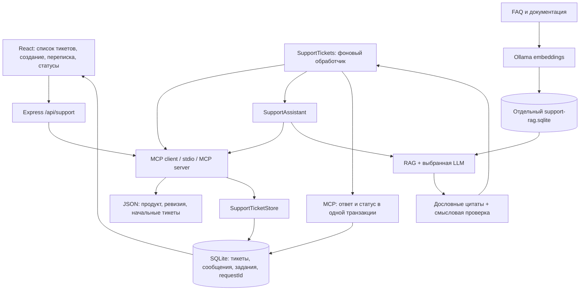

# День 33. Поддержка пользователей через тикеты

## Работа пользователя

1. Нажать **«Создать тикет»**.
2. Указать тему, описание и категорию. Код ошибки, устройство, версии ОС/приложения и выполненные шаги необязательны.
3. Нажать **«Создать тикет и найти решение»**. Обращение и первое сообщение сразу сохраняются; ассистент запускается автоматически.
4. Прочитать ответ с цитатами прямо в переписке тикета и задать уточняющий вопрос там же.
5. Нажать **«Отметить решённым»**, когда проблема устранена. Новое сообщение в решённом тикете открывает его снова и запускает следующий ответ.

Кнопка **«Удалить тикет»** в шапке обращения открывает подтверждение. Тикет перемещается в **«Удалённые»** в фильтре списка; там доступна кнопка **«Восстановить тикет»**. Переписка и источники сохраняются. Активная генерация при удалении останавливается; после восстановления её можно запустить вручную кнопкой «Повторить ответ».

Закрытие вкладки не отменяет обработку. После перезагрузки доступны прежние сообщения, ответы, источники и статус. При технической ошибке вопрос остаётся сохранённым, а кнопка **«Повторить ответ»** запускает новую попытку без дублирования сообщения пользователя.

## Статусы

| Статус | Значение | Как устанавливается |
| --- | --- | --- |
| `open` — Новое | Вопрос сохранён, задание ожидает обработки | Создание, уточнение или ручное открытие |
| `in_progress` — В работе | Ассистент обрабатывает задание | Автоматически при получении задания |
| `pending` — Ожидает вашего ответа | Проверенный ответ записан; пользователь может уточнить или подтвердить решение | Автоматически после ответа, также доступен вручную |
| `escalated` — Нужен оператор | Недостаточно подтверждений либо произошла техническая ошибка | Автоматически или вручную |
| `resolved` — Решено | Пользователь подтвердил решение | Вручную |

Во время обработки ручная смена статуса и второе сообщение в том же тикете отклоняются с 409. Другие тикеты можно создавать; они ожидают своей очереди. «Нужен оператор» сохраняет состояние обращения; автоматической отправки внешнему оператору или уведомления в CRM в этой версии нет.

## Архитектура

Сервис расширяет существующий DeepChat (React + Express + TypeScript), переиспользуя его RAG и клиентов моделей. Новых зависимостей не требуется. Основной продукт — MyFamily. База знаний подготовлена по проверенному снимку Swift-кода origin/develop cbd4086; контекст берётся из самого тикета и переписки, профили пользователей не нужны. [Сценарии MyFamily и происхождение фактов](day-33-myfamily.md). Первоначальный вымышленный FlowDesk сохранён как пример в examples/support-flowdesk/ и не индексируется.



### Постоянные данные

- **JSON с `mode: "tickets"`** задаёт продукт, ревизию знаний и начальные тикеты, без пользователей. Путь задаётся на сервере: `SUPPORT_TICKETS_SOURCE_PATH`, совместимый псевдоним — `SUPPORT_CRM_PATH`. Необязательные `details` содержат device, osVersion, appVersion, triedSteps; неизвестные поля отклоняются.
- **Тикеты и переписка** хранятся в `data/support-tickets.sqlite`: таблицы `support_tickets`, `support_messages`, `support_jobs`, `support_requests`, `support_crm_sources`.
- Исходные тикеты из JSON импортируются в SQLite **один раз** при первом обращении к этому источнику. JSON при этом не изменяется. Последующие изменения тикетов выполняются через приложение; ручная правка тикета в исходном JSON не перезаписывает уже сохранённую переписку.
- Источники из разных путей JSON изолированы по SHA-256 канонического пути. Смена пути не смешивает разные наборы обращений. Путь по умолчанию сохранён при переходе к режиму без пользователей.
- **Знания продукта** находятся в `support/myfamily/develop/knowledge/`, индексируются отдельно в `data/support-rag.sqlite`. Переписка не попадает в векторный индекс.

SQLite использует WAL, `busy_timeout`, короткие транзакции и уникальный индекс одного активного задания на тикет. Создание обращения атомарно сохраняет тикет, первое сообщение и задание. Запись ответа атомарно добавляет сообщение ассистента, завершает задание и устанавливает статус. Смена статуса проверяет `revision`, чтобы устаревшая вкладка не затёрла новое состояние.

### MCP и очередь

Приложение программно вызывает фиксированные инструменты. LLM не выбирает путь к JSON/SQLite, ID владельца и операции записи.

Чтение: `list_support_records`, `get_support_context`, `get_support_ticket`.

Пользовательские изменения: `create_support_ticket`, `append_support_message`, `set_support_ticket_status`, `retry_support_ticket`.

Удаление и восстановление: `delete_support_ticket`, `restore_support_ticket`. Они проверяют revision; в совместимом старом режиме CRM также владельца. Удаление устанавливает deleted_at и атомарно отменяет queued/running задания с отзывом leaseToken. HTTP-сервер также прерывает текущую генерацию; при изменении через отдельный MCP-процесс потеря lease обнаруживается на ближайшем heartbeat. Старый обработчик не сможет записать ответ даже после восстановления тикета. Существующая SQLite автоматически получает колонки deleted_at и details_json без изменения прежних сообщений.

Обработка заданий: `claim_support_job`, `renew_support_job`, `complete_support_job`, `fail_support_job`.

В режиме tickets локальный оператор работает с общим списком без userId; новый технический автор назначается приложением. Старый режим CRM по-прежнему требует userId и проверяет владельца. Изменяющие инструменты имеют `readOnlyHint: false`; у модели нет доступа к этим инструментам. `requestId` для создания, сообщений и повтора обеспечивает идемпотентность: повтор одного запроса не добавляет ещё один тикет или сообщение; тот же ID с другим содержимым даёт 409.

Фоновый обработчик запускается вместе с HTTP-сервером и берёт задания последовательно. Сохранённые задания живут независимо от браузерного запроса. Обработчик получает право на задание на 90 секунд и продлевает его каждые 20 секунд. После аварийного перезапуска просроченное задание может забрать новый обработчик; старый `leaseToken` уже не позволяет записать ответ. При штатной остановке генерация отменяется; незавершённое задание остаётся для восстановления. Общий лимит одной попытки генерации — 9 минут.

### Ответ и уточнения

1. `SupportAssistant` проверяет наличие и актуальность индекса, затем читает описание, необязательные сведения автора и последние шесть сообщений тикета через MCP.
2. Если в беседе уже есть ответ ассистента, модель разворачивает новое уточнение в самостоятельный вопрос. Используются до четырёх предыдущих сообщений с явным ограничением длины. История помогает понять «после этого» и «а если», но не доказывает факты продукта.
3. Предыдущие ответы ассистента исключаются из MCP-доказательств. Новые факты о продукте снова должны подтверждаться документацией; жалобы пользователя подтверждают только его слова.
4. Векторный поиск по вопросу и диагностическим признакам выбирает шесть кандидатов (cosine ≥ 0.2), LLM-реранкинг оставляет до четырёх (релевантность ≥ 2). Векторизация всегда выполняется локальной Ollama, в том числе при генерации через DeepSeek.
5. Модель получает минимальный контекст аккаунта/тикета и отобранные документы. Код проверяет дословность цитат и известные ID источников; отдельный вызов той же модели проверяет смысл и выполнение вопроса. Общим инструкциям достаточно цитат документации. Утверждения о конкретном состоянии аккаунта, устройства и причине сбоя требуют MCP-подтверждения; полный контекст передаётся смысловой проверке в любом случае. Допускаются две попытки исправления.
6. Проверенный ответ вместе с цитатами, моделью и временем обработки сохраняется в сообщении тикета. При недостатке доказательств сохраняется честный отказ с рекомендацией оператора. Техническая ошибка хранится в задании, без выдуманного сообщения ассистента.

Для индекса переиспользуются `OllamaEmbeddingClient`, `RagIndexStore`, `RagRetriever`; для генерации — `modelClient`; для проверки — `answerWithGrounding`. Индекс отслеживает fingerprint документов, модели, профиля embeddings и chunking. Изменения FAQ требуют пересборки, изменения тикета и сообщения доступны следующему запросу сразу.

### Интерфейс

`SupportAssistantPage` показывает кнопку создания, фильтр по статусу, постоянную переписку, статус и подтверждение решения. Ответы загружаются из сервера; в браузере сохраняются только выбранный ID тикета. Во время обработки активный тикет опрашивается каждые две секунды, затем каждые десять; список тикетов тоже обновляется. Первоначальная модель — локальная Qwen 9B; оператор может явно выбрать DeepSeek.

## Запуск

Нужен Node.js с `node:sqlite`, зависимости проекта и запущенная Ollama.

```bash
npm ci
ollama pull nomic-embed-text-v2-moe
ollama pull qwen3.5:9b
npm run support:index
npm run dev
```

Откройте `http://127.0.0.1:5173/#support`. Для production-сборки: `npm start`, затем `http://127.0.0.1:8787/#support`. Сервер и Vite слушают только loopback.

Настройки `.env`:

```dotenv
# По умолчанию — продукт и начальные тикеты без пользователей:
SUPPORT_TICKETS_SOURCE_PATH=./support/myfamily/develop/crm.demo.json
# Постоянные обращения, сообщения и очередь:
SUPPORT_TICKETS_DB_PATH=./data/support-tickets.sqlite
# Для облачной модели используйте существующий DEEPSEEK_API_KEY.
```

Копируйте собственный JSON в игнорируемый `data/`, обновляйте знания под свой продукт, затем выполняйте `npm run support:index`. После смены `.env` перезапустите сервер. Для резервной копии тикетов используйте SQLite backup либо остановите сервер перед копированием базы; не копируйте только основной файл при активном WAL.

## API

| Метод | URL | Действие |
| --- | --- | --- |
| GET | `/api/support/status` | Состояние индекса и моделей |
| GET | `/api/support/catalog` | Все активные тикеты, users пуст; `?includeDeleted=true` включает удалённые |
| POST | `/api/support/context` | Минимальный MCP-контекст по `{ticketId?}` |
| POST | `/api/support/tickets` | `{title,description,category?,errorCode?,details?,provider?,requestId}` → 202, `{ticket,created}` |
| GET | `/api/support/tickets/:ticketId` | Полная переписка, статус, revision и задание; для удалённых требуется `?includeDeleted=true` |
| DELETE | `/api/support/tickets/:ticketId` | `{revision}` → переместить в удалённые, отменить задания и вернуть тикет с deletedAt |
| POST | `/api/support/tickets/:ticketId/restore` | `{revision}` → восстановить тикет с перепиской без автоматического повторного запуска модели |
| POST | `/api/support/tickets/:ticketId/messages` | `{input,provider?,requestId}` → 202, сохранённое сообщение и очередь ответа |
| PATCH | `/api/support/tickets/:ticketId/status` | `{status,revision}` → обновлённый тикет; `in_progress` задаётся только обработчиком |
| POST | `/api/support/tickets/:ticketId/retry` | `{provider?,requestId}` → повтор после технической ошибки |
| POST | `/api/support/index` | Пересборка базы знаний |
| POST | `/api/support/ask` | Прежний прямой вопрос без записи в тикет; для CLI/совместимости |

`requestId` — новый UUID для нового действия, прежний UUID для повтора после сетевого сбоя. Тема: 3–160 символов, описание: 10–1200, уточнение: 1–4000. `provider`: `local` (API/CLI по умолчанию) либо `cloud`. Данные тикета возвращаются сразу; ждать LLM в HTTP-запросе создания не требуется.

## Проверка и границы применения

```bash
npm run typecheck
npm run test:support
npm run test:developer
npm run test:review
npm run test:rag:retrieval
npm run test:rag:grounding
npm run build
```

Текущие проверки режима без пользователей: **28/28 тестов поддержки, 143/143 в общей регрессии**, TypeScript и production-сборка проходят. Покрыты настоящий MCP/SQLite, HTTP без userId, запрет произвольных полей, отсутствие профиля в источниках модели, сохранение старых авторов, статусов, удаления и истории при переходе с CRM. RAG-проверка с контролируемой моделью различает сведения авторов двух тикетов. Реальные модельные прогоны учитываются отдельно: прежние 10/10 относятся к режиму с профилями и не подтверждают качество нового режима.

После добавления удаления прошли 25/25 тестов поддержки. Дополнительные сценарии проверяют отмену генерации и lease, невозможность записи старым обработчиком после восстановления, идемпотентные повторы, запрет чужого владельца и устаревшей revision, сохранение удаления начального JSON-тикета после перезапуска и конкурентную миграцию прежней SQLite.

До адаптации к MyFamily в браузере пройден исторический сценарий FlowDesk с настоящим DeepSeek: создан тикет о `SSO_REQUIRED`, автоматически сохранён ответ с шестью цитатами за 9,3 секунды, затем сохранён ответ на уточнение с восемью цитатами за 11,7 секунды. После установки «Решено» и перезагрузки сохранились статус и все четыре сообщения. Исторический отчёт: [day-33-ticket-results.json](day-33-ticket-results.json). Проверены окна 1440 и 390 пикселей; горизонтального переполнения страницы и ошибок консоли нет.

Ранее зафиксированные отчёты `day-33-cloud-results.json` (6/6) и `day-33-local-results.json` (5/6) относятся к первоначальному набору прямых вопросов `/ask`, а не к новому интерфейсу жизненного цикла.

Это локальное рабочее место доверенного оператора с общим списком тикетов. Для внешнего сервиса нужны аутентификация и tenant ACL; прежние userId не являются сессиями доступа. Структурированные секреты убираются схемой; свободный текст может содержать персональные сведения и требует внимания перед облачной обработкой. UI предупреждает о передаче вопроса и контекста в DeepSeek.

Смысловую проверку делает выбранная модель отдельным вызовом; это вероятностная проверка, а не гарантия абсолютной достоверности. Для поддержки по умолчанию используется Qwen 9B, отдельно от моделей остальных разделов; настройка SUPPORT_LOCAL_MODEL меняет только её. DeepSeek доступен как облачный вариант при разрешённой передаче данных. Работа с платежами, изменение аккаунтов и внешние уведомления не входят в операции ассистента.


В новом режиме в браузере создан синтетический тикет TCK-FE7A29CC о камере без userId, с необязательными сведениями iPhone 15 / iOS 18.5. Локальная Qwen 9B записала два ответа с MCP-цитатами и документами: первоначальный за 101,6 с, уточнение о выборе видео за 68,6 с. После установки «Решено» и перезагрузки сохранены четыре сообщения, сведения тикета и статус. Прежние 9 тикетов и 14 сообщений остались без изменений. Ошибок консоли не обнаружено. Это один сквозной сценарий, не полный замер качества модели; в первом ответе остались технические и служебные формулировки. Отчёт: [day-33-ticket-context-results.json](day-33-ticket-context-results.json).


## Краткий ответ клиенту

Ответ обращён к клиенту на «вы» и начинается с действия или прямого объяснения, без отчёта об авторе тикета. Обычно это 2–4 предложения либо до трёх шагов; ограничение — три claims и 800 символов без добавленных сервером ссылок. support-reply-policy проверяет форму до смысловой верификации и просит исправить пересказ от третьего лица, лишний объём и внутренние классы. Цитаты не обрезаются; уже проверенный текст не переписывается постобработкой.

Локальная модель использует обычный массив claims до трёх пунктов. Отдельного contextClaim и обязательной MCP-ссылки в каждом ответе нет: это требование блокировало общие советы из FAQ. MCP подтверждает конкретные персональные факты, документация — общие правила и условные проверки. Последнее уточнение клиента учитывается при выборе действий и смысловой проверке, без отдельного отчётного вступления.

Путь изменения разрешения камеры в FAQ сверён с официальным руководством Apple, ссылка записана в provenance.json. Общие компоненты grounding, дословность цитат и смысловая проверка сохранены.


После изменения стиля прошли **147/147** общей регрессии и TypeScript. В браузере локальная Qwen 9B записала короткий ответ с действием на отказ в доступе к камере (71,0 с), затем ответила о галерее с учётом сообщения «доступ уже включил» (88,7 с). В переписке четыре сообщения, статус pending, сохранены MCP- и документальные цитаты. [Отчёт](day-33-reply-style-results.json). Это один диалог, не полная оценка качества; в уточнении осталось повторение рекомендации галереи.


## Исправление сбоя общих рекомендаций

В разрешённом диагностическом повторе обращения о камере DeepSeek сначала вернул пять пунктов; после исправления краткости — три пункта с точными цитатами FAQ. Код ошибочно отклонил их из-за отсутствия MCP-цитаты в каждом ответе. Требование удалено. Запрет неподтверждённых персональных утверждений сохраняется в смысловой проверке по полному контексту тикета. Регрессионный тест воспроизводит сохранённый ответ DeepSeek без новых облачных вызовов.

Ошибки генерации теперь получают безопасную конкретную категорию (формат, цитаты, стиль, подключение, лимит контекста, время), понятный текст сохраняется в задании. Сервер журналирует ID задания, этап и код без сырых ответов провайдера, токенов и содержимого тикета. Исходная причина прежнего сбоя не была сохранена; диагностический повтор воспроизвёл ошибку обязательной MCP-ссылки.


После исправления прошли **150/150** общей регрессии и TypeScript. Реальная локальная Qwen 9B проверила сохранённый ответ из единственного разрешённого диагностического повтора DeepSeek: все три пункта и ответ в целом подтверждены. Нового облачного прогона после исправления не было. Исторический сбой не содержал исходного исключения; повтор того же вопроса воспроизвёл блокировку отсутствующей MCP-ссылкой. [Отчёт](day-33-camera-failure-results.json).
